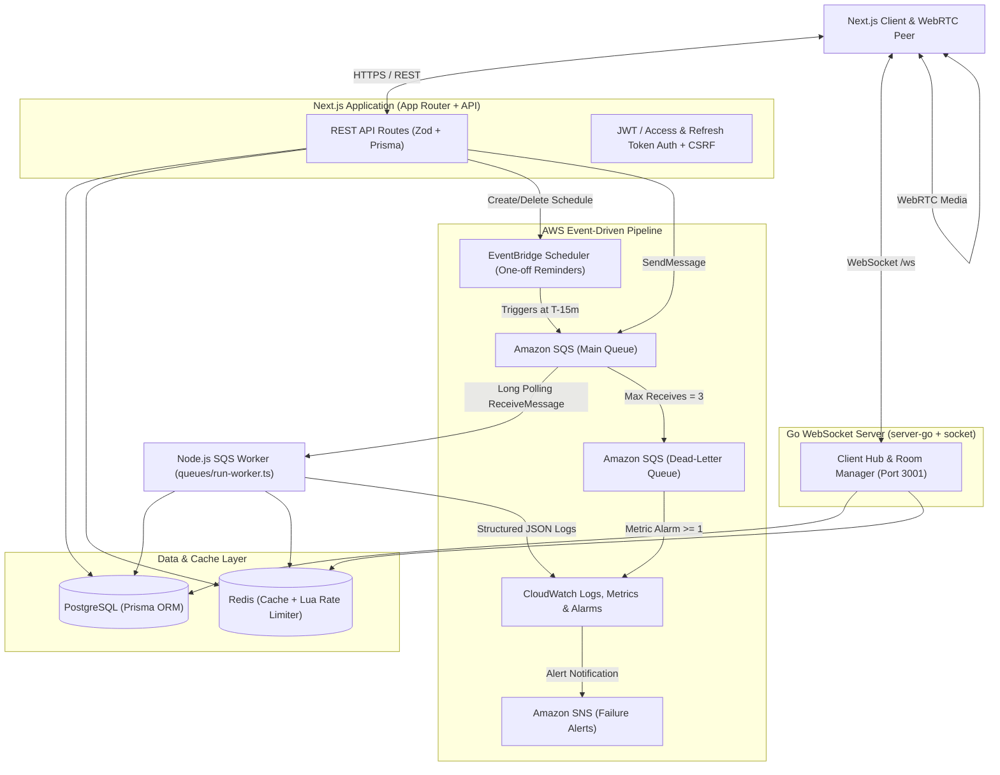

# MentorMatch

A real-time mentorship platform that connects mentors and mentees for skill-sharing, scheduled sessions, instant messaging, and peer-to-peer video calls. Built with Next.js, a high-concurrency Go WebSocket server, PostgreSQL, Redis, and an AWS event-driven background job pipeline.

---

## Table of Contents

- [Overview](#overview)
- [System Architecture](#system-architecture)
- [Key Features](#key-features)
- [Tech Stack](#tech-stack)
- [AWS Cloud & Asynchronous Pipeline](#aws-cloud--asynchronous-pipeline)
- [Redis Caching & Rate Limiting](#redis-caching--rate-limiting)
- [WebSocket Load Test Benchmarks](#websocket-load-test-benchmarks)
- [Project Structure](#project-structure)
- [Database Schema](#database-schema)
- [Getting Started](#getting-started)
- [Environment Variables](#environment-variables)
- [Available Scripts](#available-scripts)
- [Deployment](#deployment)

---

## Overview

MentorMatch facilitates structured mentorship workflows from discovery to post-session analytics:

1. **Discovery & Matching**: Search mentors by offered skills, ratings, and recommendations.
2. **Mentorship Requests**: Send, accept, or reject mentorship requests with custom messages.
3. **Scheduling & Reminders**: Schedule sessions with state-machine transitions (`PENDING` -> `CONFIRMED` -> `IN_PROGRESS` -> `COMPLETED` / `CANCELLED`) and automated reminders 15 minutes before start time via AWS EventBridge Scheduler and SQS.
4. **Real-Time Communication**: Instant messaging and call signaling powered by a dedicated Go WebSocket server, paired with peer-to-peer WebRTC video calls.
5. **Analytics & Feedback**: Asynchronous computation of active call participation metrics, mentor impact analytics, and post-session reviews.

---

## System Architecture



---

## Key Features

- **Authentication & Security**:
  - Custom JWT authentication (`ACCESS_TOKEN_SECRET`, `REFRESH_TOKEN_SECRET`) with `bcryptjs` password hashing, refresh token rotation via `AuthSession`, CSRF token verification, and account lockout protection (`failedLoginAttempts`, `lockedUntil`).
- **Mentorship Workflow**:
  - Mentorship request lifecycle (`PENDING`, `ACCEPTED`, `REJECTED`), skill-based mentor search, and personalized mentor recommendations.
- **Session Lifecycle & Video Calls**:
  - Enforced session state transitions (`CONFIRM`, `START`, `COMPLETE`, `CANCEL`) with role checks (`MENTOR` vs `ANY`).
  - Peer-to-peer WebRTC video calls with screen-sharing layout, call timer, and `CallEvent` tracking to calculate `mentorActiveMinutes`, `menteeActiveMinutes`, and `totalActiveMinutes`.
- **High-Concurrency Real-Time Messaging**:
  - Custom Go WebSocket server (`server-go` and `socket`) handling chat messages, delivery/read receipts, presence, and WebRTC signaling.
- **Cloud-Native Job Scheduling & Queuing**:
  - AWS EventBridge Scheduler for exact future session reminders without polling the database.
  - AWS SQS for durable background task execution with Dead-Letter Queue (DLQ) redrive and AWS CloudWatch observability.
- **Distributed Caching & Rate Limiting**:
  - Redis-backed cache layer across analytics, call presence, chats, mentorship requests, notifications, recommendations, sessions, and skills.
  - Tiered rate limiting using both Sliding Window and atomic Lua-scripted Token Bucket algorithms.

---

## Tech Stack

### Frontend & Full Stack
- **Next.js 16.1** (App Router, API Routes)
- **React 19** & **TypeScript**
- **Tailwind CSS v4**, **Radix UI**, and **shadcn/ui**
- **Zod** for request/schema validation
- **Framer Motion** & **Lucide React**

### Real-Time & Video
- **Go (`server-go` / `socket`)**: Custom WebSocket server with Hub/Client concurrency model
- **WebRTC**: Peer-to-peer video, audio, and screen sharing

### Database & Auth
- **PostgreSQL** via **Prisma ORM 7** (`@prisma/adapter-pg`, `pg`)
- **JWT (`jsonwebtoken`)**, **bcryptjs**, and custom CSRF utilities

### Cloud Infrastructure (AWS)
- **Amazon SQS** (`@aws-sdk/client-sqs`): Standard message queue and Dead-Letter Queue
- **Amazon EventBridge Scheduler** (`@aws-sdk/client-scheduler`): One-off UTC schedule triggers
- **Amazon CloudWatch Logs & Alarms** (`@aws-sdk/client-cloudwatch-logs`): Structured JSON logging, Logs Insights queries, and DLQ threshold alarms via **Amazon SNS**

### Caching, Rate Limiting & Benchmarking
- **Redis (`ioredis`)** & **Upstash Redis**
- **k6** for WebSocket load testing

---

## AWS Cloud & Asynchronous Pipeline

MentorMatch uses an event-driven AWS pipeline for background jobs, replacing traditional Redis-coupled queues:

1. **SQS Producer (`queues/sqs.producer.ts`)**:
   - Dispatches asynchronous jobs (`compute-session-metrics`, `send-session-reminder`, `check-auto-complete-sessions`) using `SendMessageCommand` with `TaskType` message attributes.
2. **EventBridge Scheduler (`lib/aws/scheduler.ts`)**:
   - Solves SQS's 15-minute `DelaySeconds` ceiling for sessions booked days or weeks ahead.
   - `scheduleSessionReminder()` creates a one-off `at(yyyy-mm-ddThh:mm:ss)` UTC schedule set for 15 minutes before `scheduledAt`, configured with `FlexibleTimeWindowMode.OFF` and `ActionAfterCompletion.DELETE`.
   - `cancelSessionReminder()` invokes `DeleteScheduleCommand` when a session is cancelled.
3. **SQS Long-Polling Worker (`queues/sqs.worker.ts` & `queues/run-worker.ts`)**:
   - Polls `SQS_KEY_URL` using `ReceiveMessageCommand` (`WaitTimeSeconds: 20`, `MaxNumberOfMessages: 5`, `VisibilityTimeout: 30`).
   - Explicitly calls `DeleteMessageCommand` only upon successful processing.
   - On failure, skips deletion so SQS retries up to 3 times (`maxReceiveCount: 3`) before routing poisoned messages to the Dead-Letter Queue (`SQS_DLQ_KEY_URL`).
   - Runs a lightweight 2-minute interval (`handlleAutoCompleteCheck`) to close abandoned `IN_PROGRESS` sessions and invalidate stale Redis caches.
4. **CloudWatch Observability (`lib/aws/cloudwatch.ts`)**:
   - Automatically provisions Log Group `/mentormatch/app` and stream `worker-{NODE_ENV}`, pushing structured JSON logs (`level`, `message`, `meta`, `timestamp`) queryable via CloudWatch Logs Insights.
   - Paired with a CloudWatch Metric Alarm (`ApproximateNumberOfMessagesVisible >= 1` on the DLQ) connected to an SNS email topic for immediate failure alerts.

---

## Redis Caching & Rate Limiting

### Caching (`redis/cache/`)
Dedicated cache modules with automated invalidation on mutations:
- `analytics.ts` (mentor analytics)
- `call-presence.ts` (active call participant presence)
- `chats.ts` (chat lists)
- `mentorship-requests.ts`
- `notifications.ts`
- `recommendations.ts`
- `sessions.ts` (user session lists)
- `skills.ts`

Cache hit/miss metrics are exposed via `/api/health/cache`.

### Tiered Rate Limiting (`redis/rate-limit/`)
Configured in `redis/rate-limit/tiers.ts`:

| Tier | Algorithm | Limit / Capacity | Window / Refill |
| :--- | :--- | :--- | :--- |
| `AUTH` | Sliding Window | 5 requests | 60 seconds |
| `RECOMMENDATION` | Sliding Window | 15 requests | 60 seconds |
| `MUTATION` | Sliding Window | 30 requests | 60 seconds |
| `GENERAL` | Token Bucket (Lua) | 60 tokens | 1 token / second |

---

## WebSocket Load Test Benchmarks

Load tests were executed with **k6** (`benchmark/runner.js` and `benchmark/loadtest.js`) ramping up to **800 concurrent Virtual Users (VUs)** over an 8-stage 1m20s scenario (recorded in `dontpush.txt`):

| Metric | Local Go Server (`ws://localhost:3001/ws`) | Deployed Server (`wss://socket-deploy-nbp7.onrender.com/ws`) |
| :--- | :--- | :--- |
| **Max Concurrent VUs** | 800 (min 1, max 799 active) | 800 (min 6, max 799 active) |
| **Check Success Rate (`101 Switching Protocols`)** | 100.00% (3,938 / 3,938) | 100.00% (3,414 / 3,414) |
| **Completed WebSocket Sessions** | 3,938 (44.25/s) | 3,414 (37.45/s) |
| **Messages Received** | 2,723,776 (~30,607.82 msgs/s) | 470,022 (~5,155.49 msgs/s) |
| **Messages Sent** | 5,817 (65.37 msgs/s) | 5,130 (56.27 msgs/s) |
| **Data Throughput (Received)** | 237 MB (2.7 MB/s) | 59 MB (644 kB/s) |
| **`ws_connecting` (Average)** | 22.73 ms | 1.57 s |
| **`ws_connecting` (Median)** | 8.32 ms | 1.35 s |
| **`ws_connecting` (p95)** | 106.92 ms (Threshold `< 2000ms` Passed) | 2.89 s (Threshold `< 2000ms` Exceeded on hosted tier) |
| **Iteration Duration (Average)** | 9.04 s | 10.58 s |

---

## Project Structure

```text
MentorMatch/
├── app/                                # Next.js App Router pages & REST APIs
│   ├── (auth)/                         # Sign-in and sign-up pages
│   ├── (landing)/                      # Landing page
│   ├── analytics/                      # Mentor analytics dashboard
│   ├── api/                            # Route handlers (auth, chats, sessions, health, mentors, etc.)
│   ├── chats/                          # Real-time chat UI
│   ├── notifications/                  # Notifications UI
│   ├── profile/                        # User and mentor profiles
│   ├── recommendations/                # Mentor recommendations UI
│   ├── requests/                       # Mentorship requests UI
│   ├── search/                         # Mentor search UI
│   └── sessions/                       # Session scheduling & WebRTC video call UI
├── benchmark/                          # k6 load testing scripts (runner.js, loadtest.js)
├── components/                         # React UI components (analytics, chat, video-call, ui, etc.)
├── docs/                               # Architecture, API contracts, and design documentation
├── hooks/                              # Custom React hooks (useAuth, useChatSocket, useWebRTC, etc.)
├── lib/
│   ├── auth/                           # JWT auth and CSRF token helpers
│   ├── aws/                            # AWS SDK v3 clients (sqs.ts, scheduler.ts, cloudwatch.ts)
│   ├── helpers/                        # Session metrics, recommendations, and skill helpers
│   ├── ws/                             # WebSocket client utilities
│   ├── notification.ts                 # Notification creation helper
│   └── prisma.ts                       # Prisma client singleton
├── prisma/
│   ├── schema.prisma                   # PostgreSQL database schema
│   └── migrations/                     # Prisma migration history
├── queues/
│   ├── run-worker.ts                   # Worker CLI entry point with graceful shutdown
│   ├── sqs.producer.ts                 # SQS & EventBridge Scheduler producer helpers
│   ├── sqs.worker.ts                   # SQS long-polling consumer & periodic auto-complete check
│   └── test-sqs.ts                     # Queue and scheduler verification script
├── redis/
│   ├── cache/                          # Domain-specific Redis cache modules
│   ├── rate-limit/                     # Sliding window, Lua token bucket, and tier configs
│   ├── auth-limiter.ts                 # Auth rate limiting
│   ├── cache.ts                        # Core cache utility
│   └── redis.ts                        # ioredis client with retry & shutdown handling
├── schema/                             # Zod validation schemas
├── server-go/                          # Go WebSocket server entry point, config, db, dto, httpx
├── services/                           # Frontend API service layer
├── socket/                             # Go WebSocket server hub, client management, and handlers
└── types/                              # Shared TypeScript interfaces
```

---

## Database Schema

Managed via PostgreSQL and Prisma (`prisma/schema.prisma`). Core models:

- **User**: Account credentials, profile bio, `averageRating`, `ratingCount`, lockout fields (`failedLoginAttempts`, `lockedUntil`), and skill relations (`skillsOffered`, `skillsWanted`).
- **AuthSession**: Refresh token storage and expiration tracking.
- **Skill**: Normalized skill catalog linked to mentors and mentees.
- **MentorshipRequest**: Request lifecycle (`PENDING`, `ACCEPTED`, `REJECTED`) linking mentor, mentee, and skill.
- **Session**: Scheduled sessions with unique `roomId`, status tracking, call timestamps, active participant minutes (`mentorActiveMinutes`, `menteeActiveMinutes`, `totalActiveMinutes`), `metricsComputedAt`, and `completedBy`.
- **CallEvent**: Timestamped WebRTC call events used for computing active participation metrics.
- **Chat & Message**: Conversation threads and messages with delivery/read state.
- **UserFeedback**: Post-session ratings and comments.
- **Notification**: In-app notifications (`SESSION_REMINDER`, `SESSION_SCHEDULED`, `SESSION_CANCELLED`, `FEEDBACK_RECEIVED`, etc.).

---

## Getting Started

### Prerequisites

- **Node.js 18+** and **npm**
- **Go 1.21+** (for the WebSocket server)
- **PostgreSQL**
- **Redis** (local or Upstash)
- **AWS Account** (SQS main queue, SQS DLQ, EventBridge Scheduler execution role, and IAM credentials)
- **k6** (optional, for running WebSocket load tests)

### Installation

1. Clone the repository:
   ```bash
   git clone <repository-url>
   cd MentorMatch
   ```

2. Install Node.js dependencies:
   ```bash
   npm install
   ```

3. Configure your `.env` file (see [Environment Variables](#environment-variables)).

4. Run Prisma database migrations:
   ```bash
   npx prisma migrate dev
   ```

### Running Locally

Start the Next.js app and the Go WebSocket server concurrently:
```bash
npm run dev:all
```

In a separate terminal, start the AWS SQS background worker:
```bash
npm run worker
```

Or start each service individually:
```bash
# Next.js frontend and API routes (port 3000)
npm run dev

# Go WebSocket server (port 3001)
npm run dev:socket

# SQS Background Worker
npm run worker
```

---

## Environment Variables

| Variable | Description | Required |
| :--- | :--- | :--- |
| `DATABASE_URL` | PostgreSQL connection string | Yes |
| `PORT` | HTTP port used by Go server config | Yes |
| `SOCKET_PORT` | WebSocket server port (e.g., `3001`) | Yes |
| `ACCESS_TOKEN_SECRET` | JWT signing secret for access tokens | Yes |
| `REFRESH_TOKEN_SECRET` | JWT signing secret for refresh tokens | Yes |
| `WEBHOOK_SECRET` | Webhook verification secret | Yes |
| `REDIS_URL` | Redis connection URL (`redis://` or `rediss://`) | Yes |
| `UPSTASH_REDIS_REST_URL` | Upstash REST endpoint | Yes |
| `UPSTASH_REDIS_REST_TOKEN` | Upstash REST token | Yes |
| `REDIS_TTL` | Default cache TTL in seconds | Yes |
| `REDIS_TIMEOUT` | Redis connection timeout in ms | Yes |
| `REDIS_MAX_RETRY` | Max retry attempts for Redis | Yes |
| `NEXT_PUBLIC_APP_URL` | Base URL for Next.js application | Yes |
| `NEXT_PUBLIC_SOCKET_URL` | WebSocket server URL | Yes |
| `AWS_REGION` | AWS region (e.g., `ap-southeast-2`) | Yes |
| `AWS_ACCESS_KEY_ID` | IAM user access key ID | Yes |
| `AWS_SECRET_ACCESS_KEY` | IAM user secret access key | Yes |
| `SQS_KEY_URL` | Main AWS SQS queue URL | Yes |
| `SQS_DLQ_KEY_URL` | AWS SQS Dead-Letter Queue URL | No |
| `AWS_SQS_QUEUE_ARN` | Main SQS queue ARN for EventBridge target | Yes |
| `AWS_SCHEDULER_ARN` | IAM execution role ARN for EventBridge Scheduler | Yes |
| `CLOUDWATCH_LOG_GROUP` | CloudWatch Log Group name (default: `/mentormatch/app`) | No |

---

## Available Scripts

```bash
npm run dev            # Start Next.js development server
npm run dev:socket     # Start Go WebSocket server (go run server-go/main.go)
npm run dev:all        # Start Next.js and Go WebSocket server concurrently
npm run worker         # Start the AWS SQS background worker (tsx queues/run-worker.ts)
npm run build          # Build Next.js application for production
npm start              # Start production Next.js server
npm run lint           # Run ESLint
npm test               # Run k6 load test against local WebSocket server
npm run test:deployed  # Run k6 load test against deployed WebSocket server
```

---

## Deployment

- **Frontend & API**: Deployed on Vercel (`https://mentor-match-taupe.vercel.app/`).
- **WebSocket Server**: Go binary deployed on Render (`wss://socket-deploy.onrender.com/ws`).
- **Background Processing & Observability**: Managed on AWS (SQS, EventBridge Scheduler, CloudWatch Logs/Alarms, SNS).
